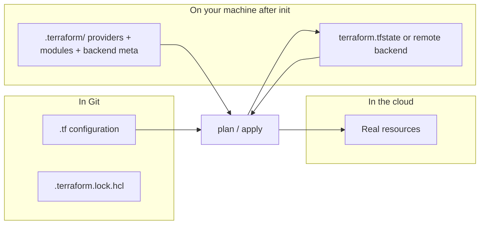

# The `.terraform/` directory

What appears after `terraform init`, what it is **not**, and how it differs from state files. Related: [03b — init](03b-init/README.md), [06 — state](../06-state/README.md).

---

## One sentence

**`.terraform/` is Terraform’s local working-directory cache and backend wiring.** It is created on your machine by `terraform init`. It is **not** your infrastructure state file and it is **not** committed to Git in normal projects.

---

## How it appears

| Situation | Do you have `.terraform/`? |
|-----------|------------------------------|
| Fresh `git clone` (only `.tf` files + `.terraform.lock.hcl`) | **No** — until you run `init` |
| After `terraform init` in that directory | **Yes** |
| Copied an old project folder from another laptop (including hidden dirs) | **Maybe** — even if you never ran `init` on *this* machine |
| IDE, script, or agent ran `init` for you | **Yes** — same as if you ran it yourself |

If you see `.terraform/` but do not remember running `init`, check whether the whole folder was copied or something automated the workflow.

---

## What is inside (typical layout)

```
my-stack/
├── main.tf
├── .terraform.lock.hcl      ← version lock (commit this)
├── terraform.tfstate        ← resource state (default local backend; usually gitignored)
└── .terraform/              ← created by init (gitignore this)
    ├── providers/
    │   └── registry.terraform.io/
    │       └── hashicorp/aws/x.y.z/.../terraform-provider-aws_*   ← executable plugin
    ├── modules/
    │   └── modules.json     ← cached copies of registry modules
    └── terraform.tfstate    ← **backend metadata only** (which backend is configured)
```

### `.terraform/providers/`

- Downloaded **provider plugins** (AWS, Azure, `random`, etc.).
- Terraform **executes** these binaries during `plan` / `apply`.
- They must be **executable** (`chmod +x`). If permissions are wrong (e.g. `644` after a copy), you get: `fork/exec … permission denied`.
- Fix: `find .terraform/providers -name 'terraform-provider-*' -exec chmod +x {} \;` or `rm -rf .terraform && terraform init`.

### `.terraform/modules/`

- **Cached module sources** (registry modules, local paths still resolve from your `module` blocks).
- Lets Terraform run without re-downloading modules on every command.

### `.terraform/terraform.tfstate` (small file inside `.terraform/`)

- **Not** the same as `terraform.tfstate` in the project root.
- Stores **backend configuration** for this working directory (e.g. “local” or “S3 bucket X”).
- Exam trap: “state file” usually means **resource state** (`terraform.tfstate` or remote backend), not this internal file.

---

## What `.terraform/` is **not**

| Item | Role |
|------|------|
| **`terraform.tfstate` (project root)** | Maps resources to real cloud IDs; sensitive; **state** for exam objectives |
| **`.terraform.lock.hcl`** | Pins provider versions; **commit to Git**; lives next to `.tf`, not inside `.terraform/` |
| **Your `.tf` configuration** | Source of truth for *desired* infrastructure; always in Git |
| **Remote state in S3 / HCP Terraform** | Real state for teams; `.terraform/` on your laptop is still just local cache + backend setup |

`terraform init` does **not** create EC2 instances, VPCs, or databases. It only prepares the directory.

---

## Git: ignore `.terraform/`, keep the lock file

Standard `.gitignore`:

```gitignore
.terraform/
*.tfstate
*.tfstate.*
```

**Do commit:** `.terraform.lock.hcl` so everyone uses the same provider versions.

**Do not commit:** `.terraform/` (machine-specific, large binaries) or `terraform.tfstate` (secrets and resource IDs).

---

## Safe operations

| Goal | Command / action |
|------|------------------|
| Fresh plugins on a new laptop | `rm -rf .terraform` then `terraform init` |
| Update providers within constraints | `terraform init -upgrade` |
| Backend block changed | `terraform init -migrate-state` or `-reconfigure` (see 03b) |
| “Start over” on **plugins only** | Delete `.terraform/`, run `init` again |

Deleting `.terraform/` does **not** delete cloud resources. It only removes local cache; the next `init` re-downloads providers and modules.

Deleting **`terraform.tfstate`** (root) without a remote backend is different: Terraform “forgets” what it created unless you import or recreate. Treat that as a state decision, not a cache cleanup.

---

## Mental model (exam + real projects)



- **Configuration** → what you want  
- **State** → what Terraform thinks exists  
- **`.terraform/`** → how this directory runs (plugins, module cache, backend hookup)

---

## Quick self-check

1. After `git clone`, is `.terraform/` present? → **Only if something else created it; not from Git itself.**
2. Does `init` create infrastructure? → **No.**
3. Should `.terraform.lock.hcl` be committed? → **Yes.**
4. Should `.terraform/` be committed? → **No.**
5. Plan fails with `permission denied` on `terraform-provider-*`? → **Fix execute bit or re-`init`.**
